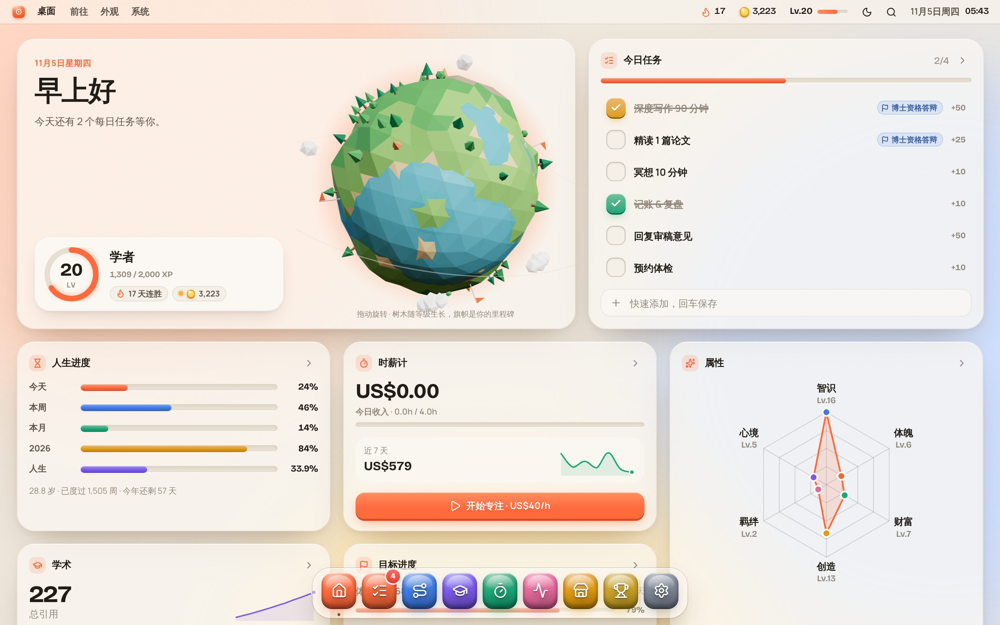
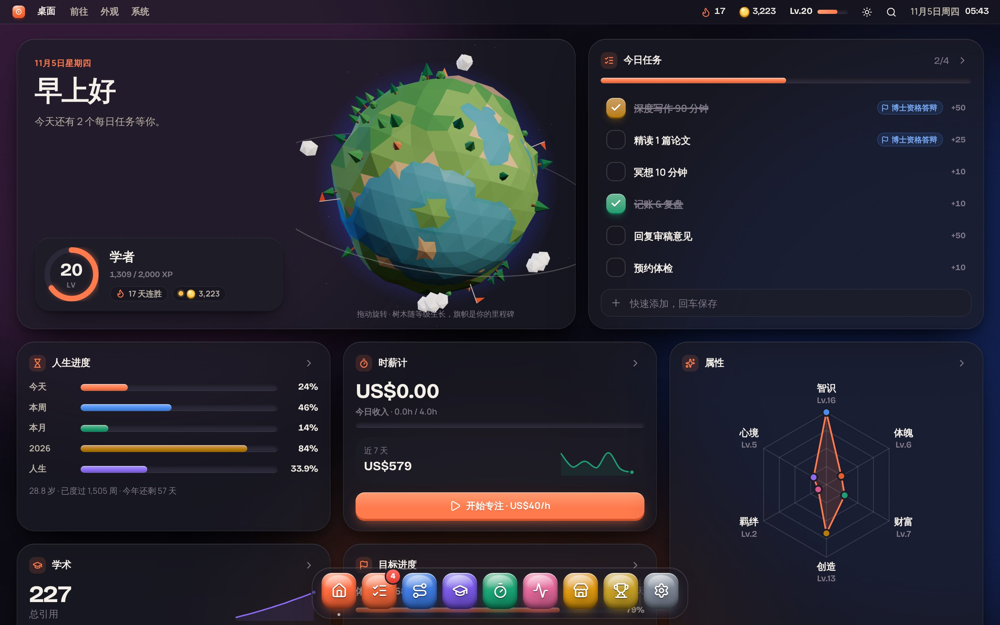
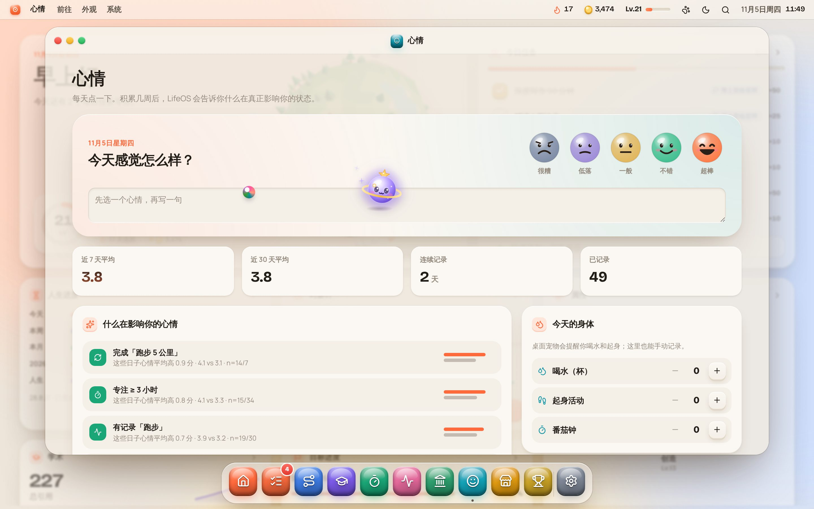
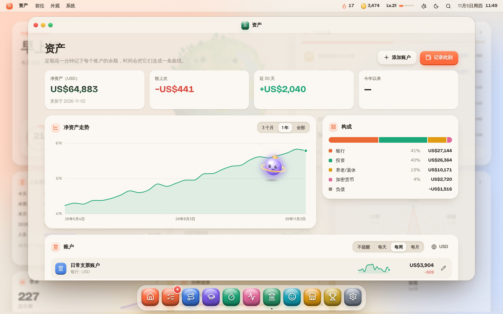

<div align="center">


# LifeOS

**一个为你的人生运行的操作系统。**
*An operating system for your life.*

任务 · 里程碑 · 学术与引用 · 时薪计 · 习惯追踪 · 奖励商店 · 成就 —— 全部变成一场可以升级的游戏。

</div>



| 暗夜模式 Dark | 时薪计 Earn |
| --- | --- |
|  |  |
| 心情 Mood | 资产 Assets |
|  |  |
| 桌面宠物 Pets | |
|  | |

---

## 它是什么

LifeOS 把人生里分散的系统——每日清单、人生里程碑、论文与引用、工作时长与收入、身体与阅读数据——收进一个**像操作系统一样的桌面**里，并用游戏化机制把它们串起来：

- **桌面 Desktop**：问候、可拖动旋转的 3D「人生星球」（树木随等级生长，旗帜是你达成的里程碑，月亮绕行速度随连胜加快）、今日任务、人生进度条（今天 / 本周 / 本月 / 今年 / 一生）、属性雷达、XP 热力图。
- **任务 Quests**：每日习惯 + 一次性任务，一行快速添加（以 `!` 开头 = 每日习惯）。按难度给 XP，当天安排的全部完成触发「全勤日」奖励，支持回看 / 补打卡前几天。
- **人生地图 Roadmap**：进行中的目标（关键结果、实时进度、倒计时、可拆解步骤、领取奖励）、已抵达的里程碑，以及「人生周格」——一生约 4,400 周，每一格一周，里程碑标在格子上。
- **学术 Research**：论文看板（想法 → 写作 → 投稿 → 审稿 → 接收 → 发表，每推进一步都有 XP），总引用 / h-index / i10 自动计算，引用曲线；可一键从 **OpenAlex** 或 **Semantic Scholar** 同步论文和引用数。
- **时薪计 Earn**：可以指定「为哪个任务 / 目标工作」。开始后收入以滚轮数字**逐秒上涨**；每 15 分钟掉一次金币，浏览器标签页标题实时显示本次收入，菜单栏有常驻计时胶囊。每专注 1 分钟 +1 XP。
- **资产 Assets**：银行、券商、退休账户、加密货币、负债……每个账户可以用不同币种。按每天 / 每周 / 每月提醒你「此刻各账户里有多少」，预填上次数字、只改变化的；自动折算成净资产曲线和资产构成。汇率可手动填写，也可以一键在线更新。
- **心情 Mood**：每天点一下心情（宠物晚上也会来问你）。积累几周后自动找出影响心情的因素，例如「跑步的日子心情平均高 0.9 分」「专注 ≥3 小时」「喝水 ≥6 杯」，并附带样本数。同时记录喝水、起身、番茄钟。
- **追踪 Trackers**：体重、跑量、阅读、睡眠……任意数值，「最新读数」或「累计」两种模式，带目标和趋势图。
- **奖励商店 Shop**：XP 会同时产出金币（5 XP = 1 币）。给自己想要的犒劳定价，用金币兑换。
- **成就 Trophies**：等级与称号、六维属性（智识 / 体魄 / 财富 / 创造 / 羁绊 / 心境），25 枚青铜 → 传说徽章。
- **系统设置 Settings**：几乎一切都可以改——
  - **程序坞**：拖动排序、显示 / 隐藏应用（隐藏的仍可在 ⌘K 里打开）；**桌面小组件**逐个开关，桌面自动重排。
  - **属性**：改名、换图标、换颜色、增加或删除（3–10 个）；删除时可选择把相关任务和已获得的 XP 合并到哪个属性。
  - **工作与收入**：按时薪 / 日薪 / 月薪 / 年薪填写，自动换算出每秒跳钱的速度；「为谁工作」列表（雇主、客户、项目）可增删，每项可设独立时薪，时薪计按项目统计收入。
  - **桌面宠物**：开关、三选一、改名、活跃程度、喝水 / 久坐提醒间隔、番茄钟时长、提示音、浏览器通知。
  - 以及中英双语、明亮 / 暗夜 / 跟随系统、动效减弱、JSON 导出 / 导入备份。

### 桌面宠物

三只原创的黏土风小伙伴：**团子**（会蹦跳的橘子团子猫）、**小电**（喷气飞行的薄荷小机器人）、**星灵**（带星环的紫色小星球）。

- 在桌面上自己溜达：**坐在面板顶上**、**躲在面板后面探头**（偶尔缩回去再冒出来）、睡觉冒 Zzz、追彩球玩；眼睛会跟着你的鼠标转。
- 可以**拖起来扔到任意面板上**；点它打开菜单：摸摸、喝水 +1、起身、番茄钟、一起玩、睡觉。
- 菜单栏的 🐾 按钮（或 ⌘K「找到我的宠物」）**一键定位**：聚光灯 + 涟漪，宠物瞬移到屏幕中央。
- 会对 LifeOS 里发生的事做出反应：得到 XP 时开心跳一下，升级 / 成就时撒金币和星星。
- **提醒**：喝水、久坐（计时器在跑或你一直在操作时累计）、番茄钟结束、资产盘点到期、晚上的心情打卡。数据都会记下来，并用于心情关联分析。
- 打开应用窗口时它会躲到两侧或坐到 Dock 上，不挡内容；手机上就住在 Dock 上。设置里一键关闭。

### 联动：小事如何自动推动大目标

LifeOS 不是一堆互不相干的清单。最小的一次打卡，会沿着这条链自动向上传导——**不需要手动去改任何进度**：

```
 每日任务 ✓ ──┬──► 自动记录到追踪（例：「跑步 5 公里」→ 跑量 +5 km）
              └──► 计入目标的「关联任务次数」
 专注计时 ⏱ ──┬──► 当天专注够时长，任务自动打勾（例：「深度写作 90′」）
              └──► 计入目标的「专注小时」
 追踪数据 ────────► 目标的「追踪」关键结果（累计跑量 400 km / 体重降到 68 kg）
 论文 · 引用 · 收入 · 净资产 · 等级 · 连胜 ──► 目标的「系统指标」关键结果
                                        │
                       全部关键结果达成 ─┴─► 通知「可以领取」→ 领取 XP → 星球上插一面旗
```

- **目标 = 里程碑 + 关键结果（OKR）**。关键结果有 5 种来源：关联任务次数、专注小时、追踪数据、系统指标（引用 / h-index / 接收论文 / 收入 / 净资产 / 等级 / 连胜）、手动计数。进度全部实时计算。
- 任务可以**按星期安排**（例如周一三六跑步），没安排的日子不影响全勤与连胜。
- 任务、专注记录、追踪卡片上都会显示它在推动哪个目标（小旗标签），反过来目标卡片也列出「推动它的任务」。
- **本周回顾**自动生成：XP 与专注时长对比上周、最稳定和最掉队的习惯、离达成最近的目标、还没关联目标的习惯。
- 首次启动会自动创建一个「坚持 30 天」目标并关联起步习惯，第一天就能看到这条链在工作。

系统级体验：开机动画、菜单栏（连胜、金币、等级、时钟）、带放大效果的 Dock、窗口（红黄绿按钮、双击标题栏放大）、**⌘K / Ctrl+K 聚焦搜索**（打开应用、勾选任务、开始计时、切换主题）、系统通知（成就解锁、升级）、+XP 飘字与彩纸。

## 本地运行

```bash
git clone https://github.com/yubol-bobo/LifeOS.git
cd LifeOS
npm install
npm run dev
```

打开终端里显示的地址（默认 http://localhost:5173）。第一次启动会出现设置助手，可以选择「先看看示例数据」。

构建静态文件：

```bash
npm run build
```

`dist/` 是纯静态站点，使用相对路径，可以丢到任何静态托管上（GitHub Pages、Netlify、Vercel、NAS、甚至直接本地打开预览服务）。

## 部署到 GitHub Pages

仓库自带 `.github/workflows/deploy.yml`，推送到 `main` 或 `claude/**` 分支会自动构建并发布。第一次需要在仓库里开一下：

1. **Settings → Pages → Build and deployment → Source** 选 **GitHub Actions**。
2. 如果想让非 `main` 分支（例如开发中的 `claude/...` 分支）也能发布预览：**Settings → Environments → github-pages → Deployment branches**，把该分支加进去。否则合并到 `main` 后会自动发布。
3. 发布地址：`https://<你的用户名>.github.io/LifeOS/`

Fork 之后同样适用，只需对自己的 fork 做第 1 步。

## 数据与隐私

- 没有后端、没有账号。所有数据保存在当前浏览器的 `localStorage`（键名 `lifeos:v1`）。
- 换设备或清理浏览器之前，请在 **系统设置 → 数据 → 导出备份** 下载 JSON；在新设备上导入即可。
- 只有你主动点击「同步引用」或「在线更新汇率」时，浏览器才会直接请求 OpenAlex / Semantic Scholar / open.er-api.com 的公开 API。Google Scholar 没有公开 API，无法在浏览器里同步。

### Google Scholar 自动同步（每 8 小时）

Google Scholar 没有公开 API，所以由仓库里的定时任务通过 [SerpAPI](https://serpapi.com) 抓取你的 Scholar 主页：每篇论文的引用数、新增 / 消失的论文、总引用、h-index、i10、每年引用。

1. 在 SerpAPI 注册，拿到 API key（免费额度够用）。
2. 仓库 **Settings → Secrets and variables → Actions**：
   - **Secrets** 新建 `SERPAPI_KEY`
   - **Variables** 新建 `SCHOLAR_ID`（Scholar 主页网址中 `user=` 后面那串）
   - 可选 Variables：`SCHOLAR_INTERVAL_HOURS`（默认 `8`）、`SCHOLAR_MONTHLY_LIMIT`（默认 `100`）、`SCHOLAR_TZ`（默认 `UTC`）
3. 定时任务只在默认分支（`main`）上运行。

保险措施：无论工作流被触发多少次（定时、推送、手动），脚本都保证两次抓取至少间隔 `SCHOLAR_INTERVAL_HOURS`，并且每个自然月的 SerpAPI 调用不超过 `SCHOLAR_MONTHLY_LIMIT`。100 篇论文以内每次只用 1 次调用，每 8 小时一次，约每月 90 次。

历史数据保存在 `scholar-data` 分支（不污染主分支历史），发布时打包进网站。打开 LifeOS 时会自动合并：按 Scholar 论文 ID 匹配，新论文自动加入，消失的论文只标记、不删除，新增引用每次 +2 XP，并显示每篇论文近 7 / 30 天的变化。

### 如何找到学术 ID

- **OpenAlex**：在 [openalex.org](https://openalex.org) 搜索你的名字，作者页 URL 里的 `A50...` 就是 ID；也可以直接填 `orcid:0000-0000-0000-0000`。
- **Semantic Scholar**：作者主页 URL 最后那串数字。

## 游戏规则（可以自己改）

所有数值都在 [`src/store/rules.ts`](src/store/rules.ts)：

| 行为 | XP |
| --- | --- |
| 每日 / 一次性任务 | 轻松 10 · 标准 25 · 硬核 50 |
| 全勤日（所有每日习惯完成，至少 3 个） | +30 |
| 里程碑达成 | 小目标 120 · 大目标 400 · 史诗 1000 |
| 里程碑步骤 | 15 |
| 论文推进 | 写作 40 · 投稿 150 · 接收 400 · 发表 120 |
| 专注计时 | 每分钟 1 |
| 追踪记录 | 每项每天 5 |
| 心情打卡 | 5 |
| 资产盘点 | 20 |
| 喝水 / 起身 / 番茄钟 | 2 / 4 / 10（每天有上限） |
| 成就解锁 | 青铜 50 · 白银 120 · 黄金 300 · 传说 800 |

升到第 L 级所需累计 XP 为 `50 × L × (L − 1)`。金币 = XP ÷ 5。所有 XP 都记录在一个以 `ref` 去重的账本里，取消勾选会精确撤回对应的 XP。

## 技术栈

Vite · React 19 · TypeScript · three.js（人生星球，按需懒加载）· 纯 CSS 设计系统（无 UI 框架）· lucide 图标 · Bricolage Grotesque + Manrope 字体。

```
src/
  os/        Shell、菜单栏、Dock、窗口、聚焦搜索、通知、开机与设置助手
  apps/      Desktop / Quests / Roadmap / Research / Earn / Trackers / Shop / Trophies / Settings
  store/     数据模型、XP 账本与动作、游戏规则与成就、联动层（links.ts）、示例数据
  pet/       桌面宠物：SVG 角色、行为引擎、提醒与番茄钟、音效
  scene/     three.js 低多边形星球
  ui/        按钮、卡片、进度、图表（面积 / 柱状 / 热力 / 雷达）、滚轮数字
  styles/    设计 token（明亮 / 暗夜）、基础组件、系统外壳、各应用样式
```

## License

MIT
