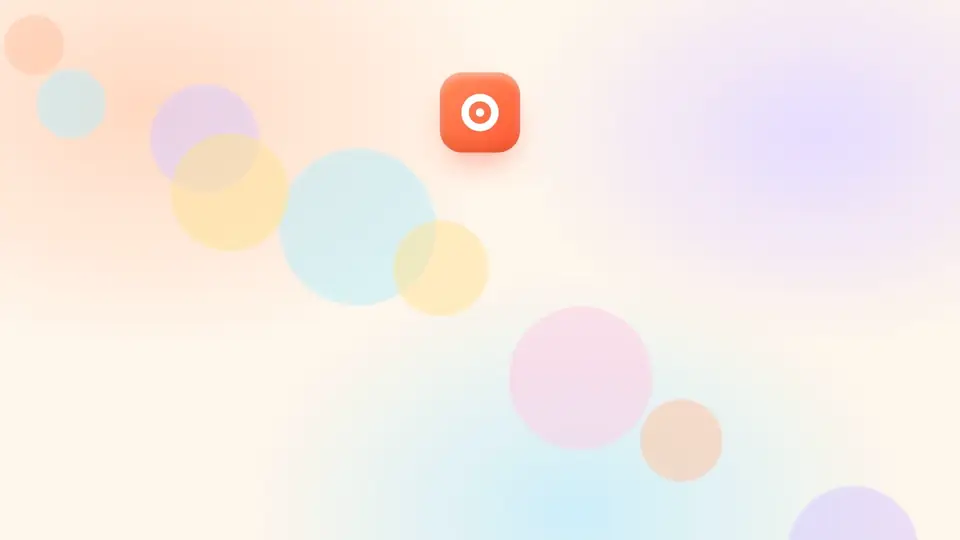
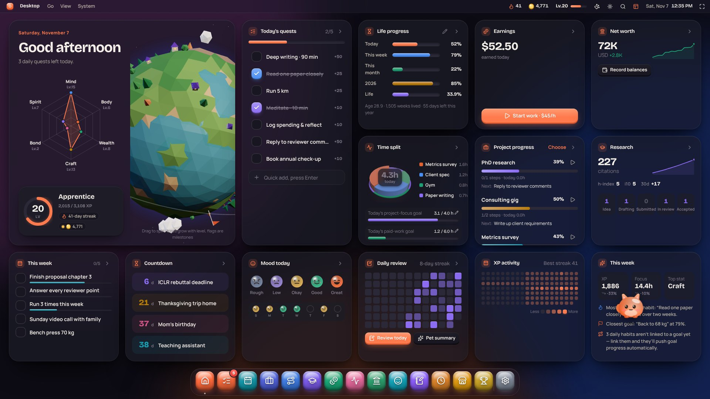
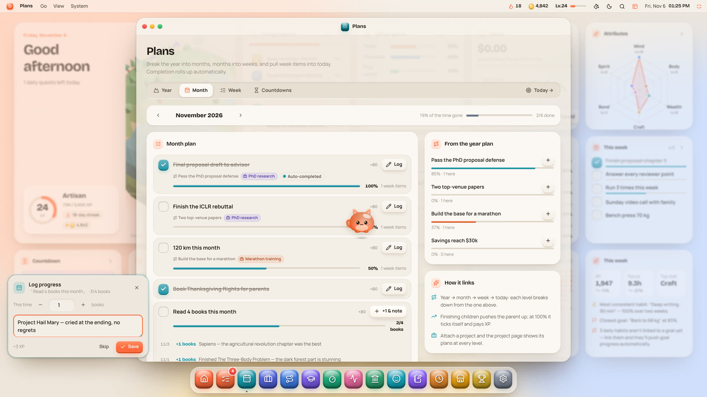
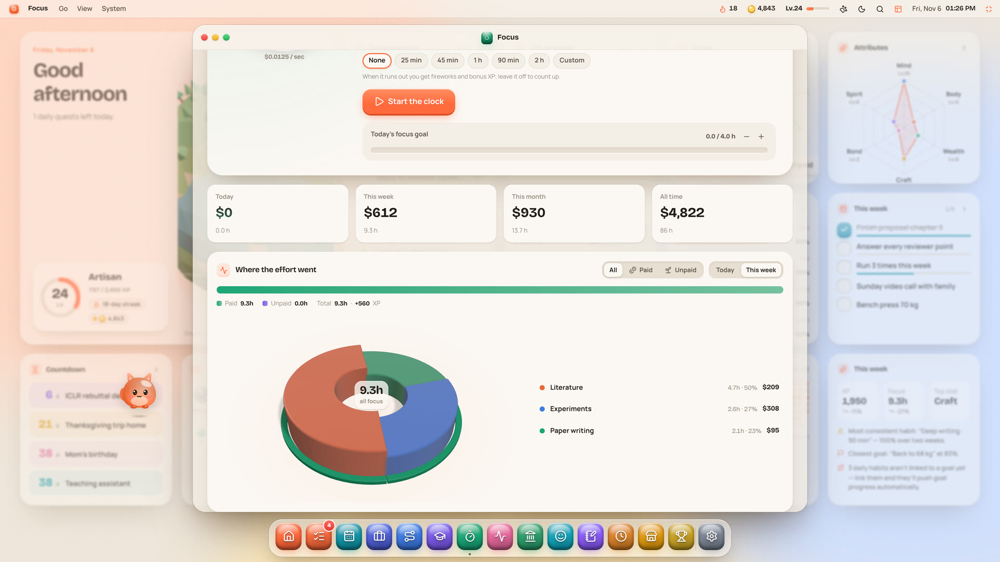
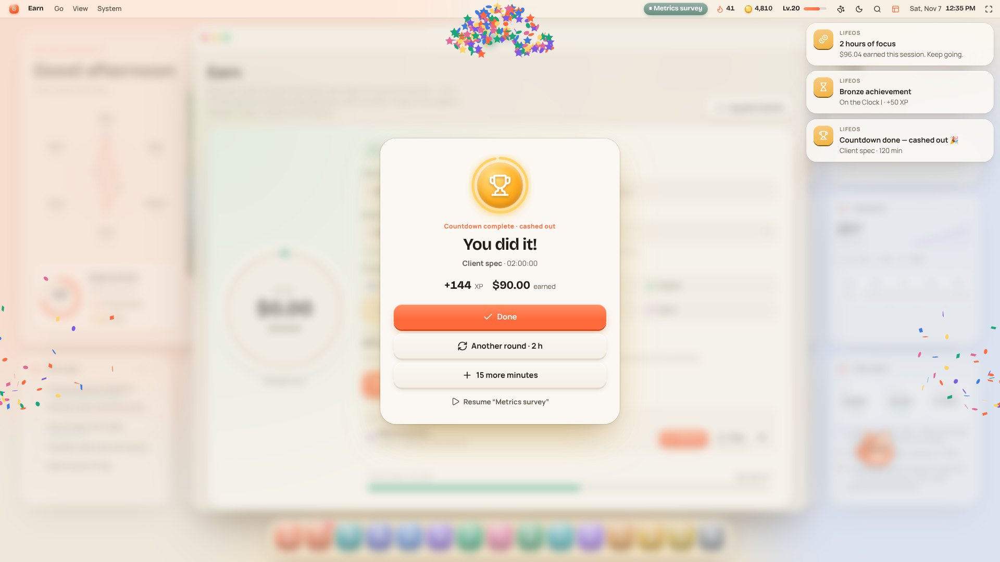
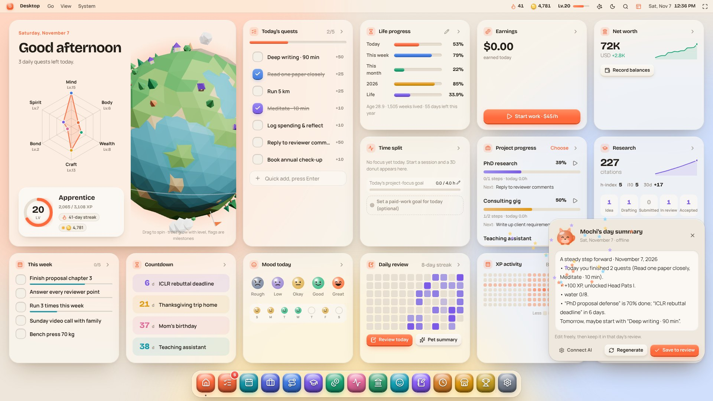
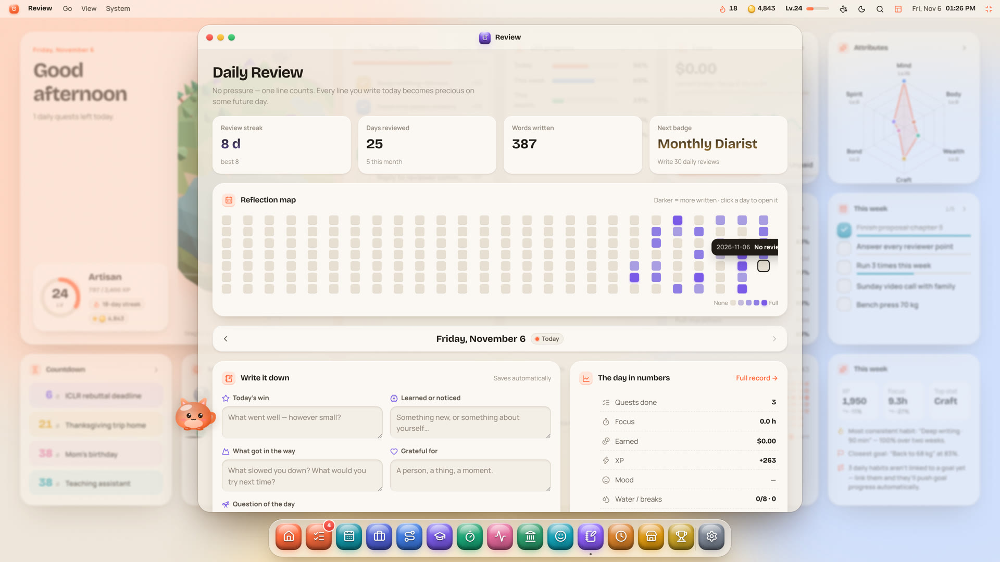
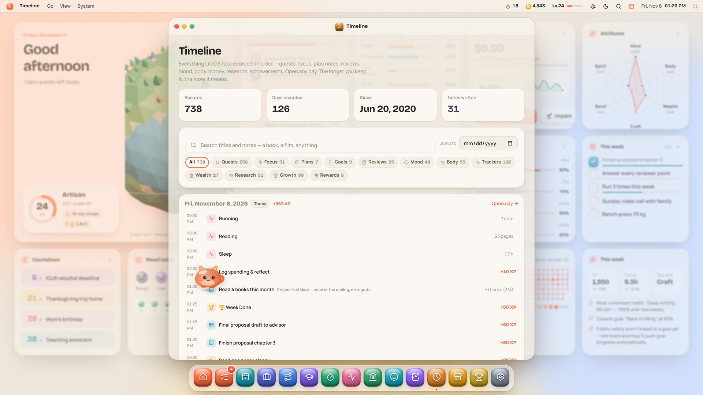
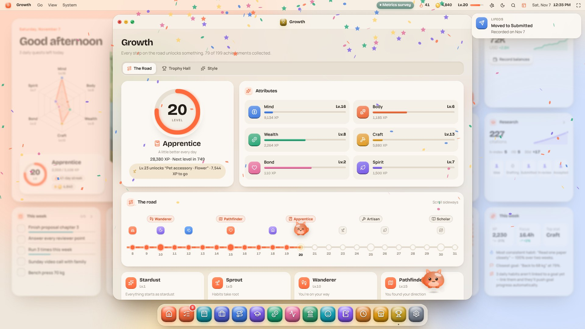

<div align="center">


# LifeOS

**An operating system for your life.**

Capture the small moments of every day, and keep them visible, traceable, and yours.

**English** · [中文](README.zh-CN.md)

[**▶ Try it live**](https://yubol-bobo.github.io/LifeOS/) · [**Watch the video**](https://yubol-bobo.github.io/LifeOS/promo/) · [Setup guide](SETUP.md) · [Feature guide](docs/FEATURES.md) · [Changelog](CHANGELOG.md)

<a href="https://yubol-bobo.github.io/LifeOS/promo/"></a>

<sub>↑ Click to watch the full 80-second tour (with voiceover and sound)</sub>

</div>

---

## Why LifeOS

In the age of AI, information is exploding. Models have read the whole internet, yet they know nothing about **you**: the book you finished today, the problem you got stuck on, which days you felt your best, where your hours actually went.

Public data is everywhere. **Your own data is what's scarce, and it's becoming the most valuable data you have.** Today it's scattered across notes apps, calendars, budgeting tools and your memory, and most of it is gone within a few months.

LifeOS is built around three ideas:

- **Make recording effortless, even fun.** Quests, focus sessions and reflections earn XP. Levels, achievements, a planet that grows with you and a desktop pet keep you coming back.
- **Make everything visible and traceable.** Open any day and see what you did, how long you focused, how you felt and what you wrote.
- **Your data stays yours.** No server, no account. Everything lives in your browser; multi-device sync is end-to-end encrypted into your own private Gist.

## What it does

| | |
| --- | --- |
| 🖥️ **Desktop** | An OS-style dashboard: today's quests, life progress, attribute radar, XP heatmap, and a 3D planet that grows as you level up |
| ✅ **Quests & plans** | Daily habits and one-off tasks; break the year into months, weeks and today, with progress flowing upward; log a note at every step of plans like "read 8 books" |
| ⏱️ **Focus** | Paid work (watch earnings tick up by the second) and unpaid effort (gym, writing, reading…); set a countdown and get a celebration when it ends; a 3D donut shows where your hours went |
| 🐾 **Desktop pets** | Three companions remind you to drink water, stretch and sleep; connect OpenAI, Claude, DeepSeek, Kimi or GLM and your pet writes up your day each night |
| 📝 **Daily review** | One line is enough: highlight, lesson, blocker, gratitude, tomorrow's one thing; a reflection heatmap and "one year ago today" |
| 🕰️ **Timeline** | Everything LifeOS recorded, in order, searchable and filterable; open any day for a cute 3D XP-blocks view |
| 🌱 **Growth** | 60 levels, 10 eras, 197 achievements; unlock pet accessories, wallpapers and planet upgrades |
| 📊 **And more** | Mood and what drives it, assets and net worth, papers and citations (auto-sync from Google Scholar), custom trackers, a reward shop |

English and Chinese · light and dark themes · portrait card feed or full-screen landscape dashboard · works on phones. Every feature in detail: **[Feature guide](docs/FEATURES.md)**.

## Screenshots

| | |
| --- | --- |
|  |  |
| **Desktop** (dark mode) | **Plans**: a note at every step |
|  |  |
| **Where the effort went**: 3D donut | **Countdown done**: confetti |
|  |  |
| **Your pet's day summary** | **Daily review** and reflection heatmap |
|  |  |
| **Timeline**: everything traceable | **The road**: 10 eras |

---

## Getting started

### 1. Try it (1 minute)

Open **<https://yubol-bobo.github.io/LifeOS/>** and choose "Explore with demo data" in the setup wizard. When you're ready to start for real, go to **Settings** and click "Clear & start".

> Everyone who opens that URL sees the LifeOS **in their own browser**. Nobody can see anyone else's data.

### 2. Get your own LifeOS (recommended, 3 steps)

1. Click **Fork** at the top right of this repo.
2. In your fork, open **Settings → Pages → Source** and choose **GitHub Actions**.
3. Wait a minute or two, then open `https://<your-username>.github.io/LifeOS/`.

When the original project updates, click **Sync fork** on your repo page to upgrade ([details](SETUP.md#11-updating-a-fork-and-extending-lifeos)).

### 3. Optional extras

| You want | How | Details |
| --- | --- | --- |
| Sync between computer and phone | Settings → Sync: a GitHub token with only the `gist` scope, plus a sync password you choose | [SETUP §8](SETUP.md#8-sync-between-devices) |
| Your pet writes a day summary | Settings → AI: pick a provider and paste your API key | [SETUP §9](SETUP.md#9-ai-pet-day-summary) |
| Google Scholar citations, auto-synced | Repo secret `SERPAPI_KEY` + repo variable `SCHOLAR_ID` | [SETUP §3–4](SETUP.md#3-google-scholar-id) |
| Reminders even from other tabs | Settings → Desktop Pet → Browser notifications | [SETUP §7](SETUP.md#7-browser-notifications-pet-reminders) |

Keys and tokens go **only into the web page or GitHub Secrets**, never into code. The full checklist is in **[SETUP.md](SETUP.md)**.

### 4. A day with LifeOS

- **Morning**: glance at today's quests and countdowns; in Plans, send this week's items to today.
- **During the day**: start a Focus session before you work (add a countdown if you like), tick things off, and watch XP and progress add up.
- **Evening**: tap your mood, spend a minute on the review, or click your pet → "Day summary", tweak it and save it to your review.
- **Looking back**: open Timeline, or click any day on any heatmap.

Tip: `⌘K` / `Ctrl+K` searches and opens everything; the top-right buttons switch to the landscape dashboard and full screen.

### 5. Backups

Your data lives in the browser. Before switching computers or clearing browser data, go to **Settings → General → Export backup** and import the JSON on the new device. With sync turned on, you don't need to worry about this.

---

## Data & privacy

- **No backend, no account.** Data is stored in your browser's `localStorage`.
- **Sync is end-to-end encrypted.** Data is encrypted on your device before it goes into your own private Gist; GitHub can't read it.
- **AI is optional.** Your key stays in the current browser. When generating a summary, the browser sends that day's digest directly to the provider you chose, with no server in between.
- **Safe to fork.** The repo contains only code and fictional demo data. Your records, keys and passwords are never in it ([details](SETUP.md#10-use-it-yourself-while-others-fork-it-privacy)).

## Development

```bash
git clone https://github.com/yubol-bobo/LifeOS.git
cd LifeOS
npm install
npm run dev
```

`npm run build` outputs a fully static site in `dist/` that can be hosted anywhere. Pushing to `main` publishes to GitHub Pages via GitHub Actions.

Want to tweak the game balance? Every number is in [`src/store/rules.ts`](src/store/rules.ts). Code layout and tech stack: [Feature guide](docs/FEATURES.md#tech-stack).

Built with Vite, React 19, TypeScript and three.js. No UI framework and no backend.

## License

MIT. Fork it, remix it, and make it your own LifeOS.
