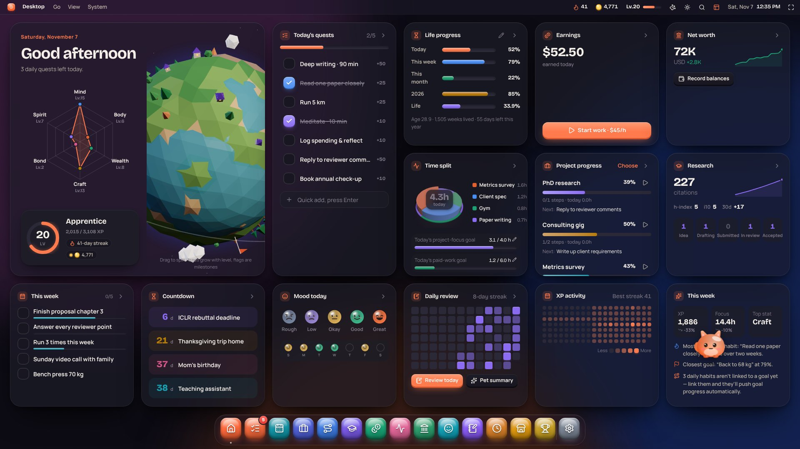
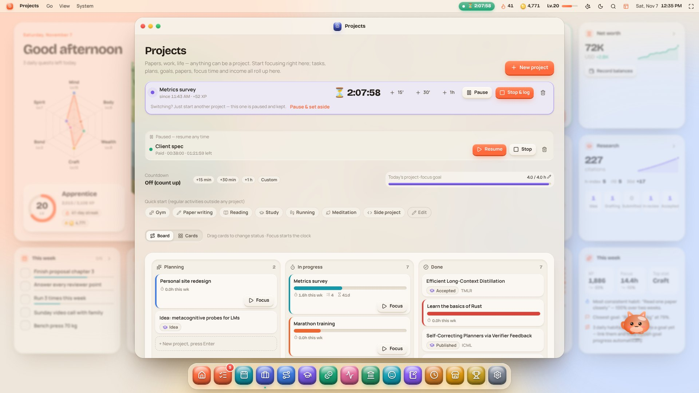
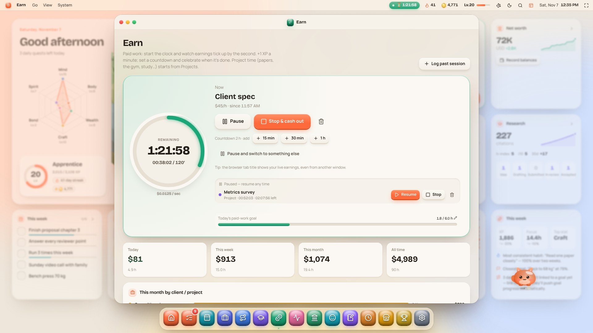
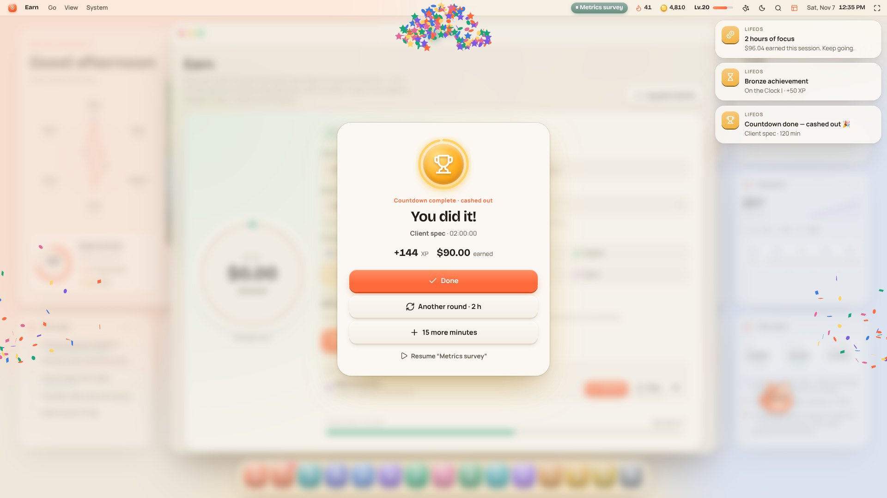
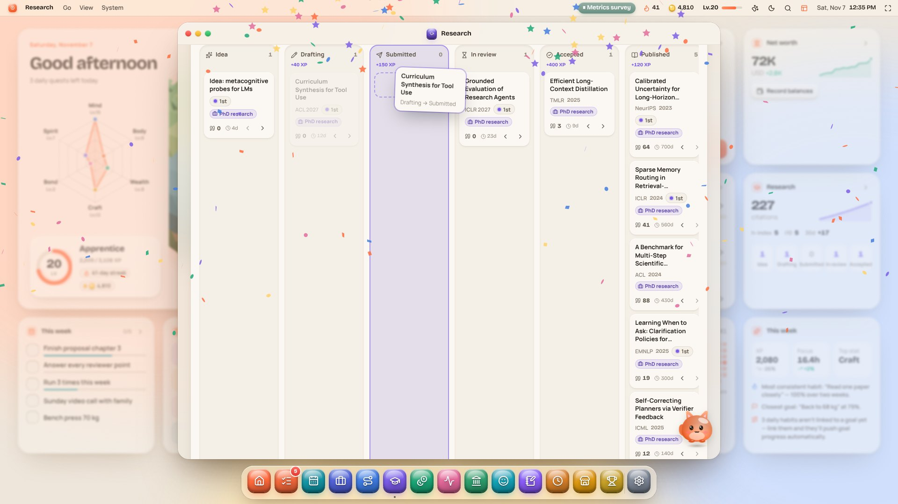
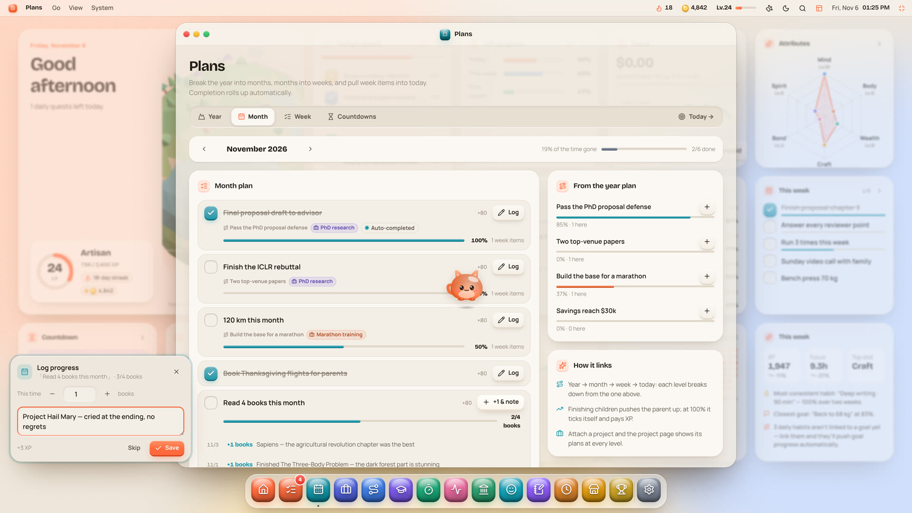
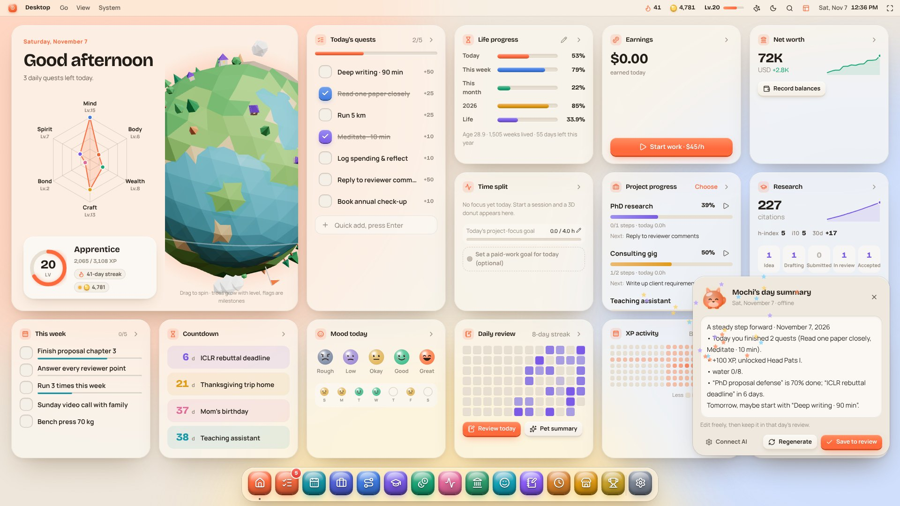
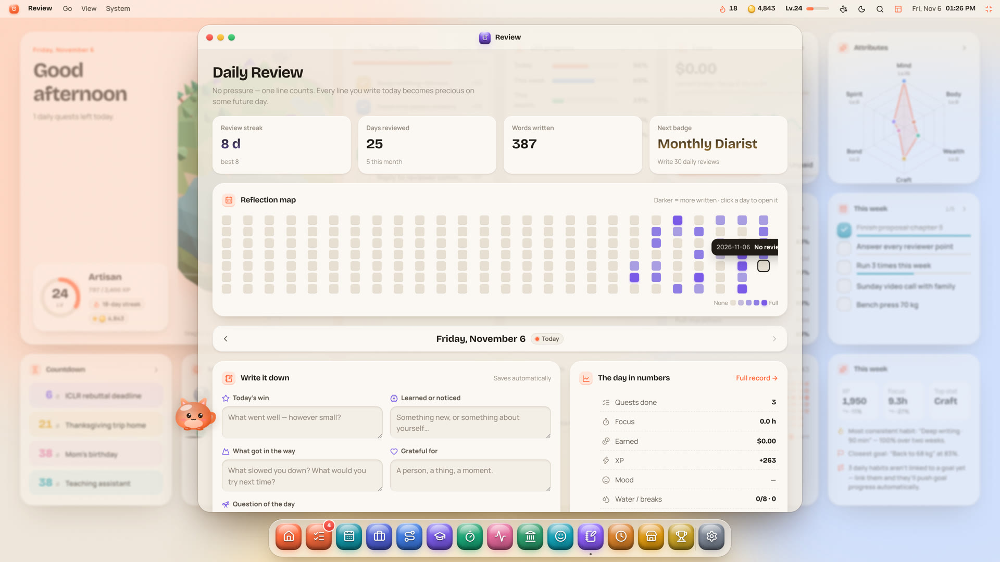
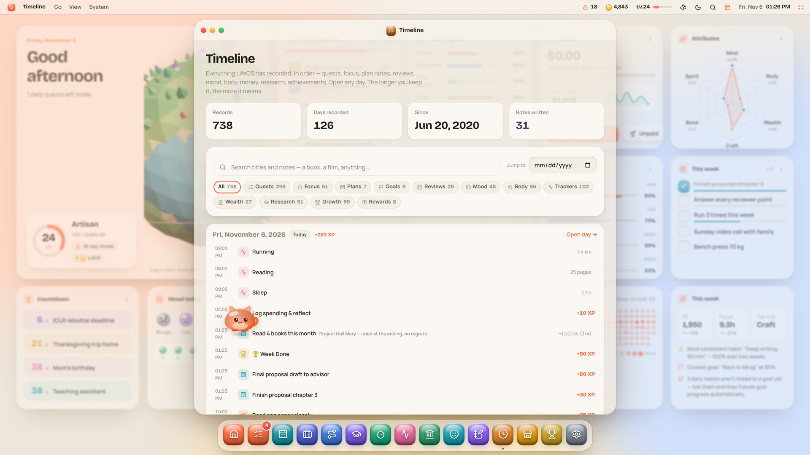
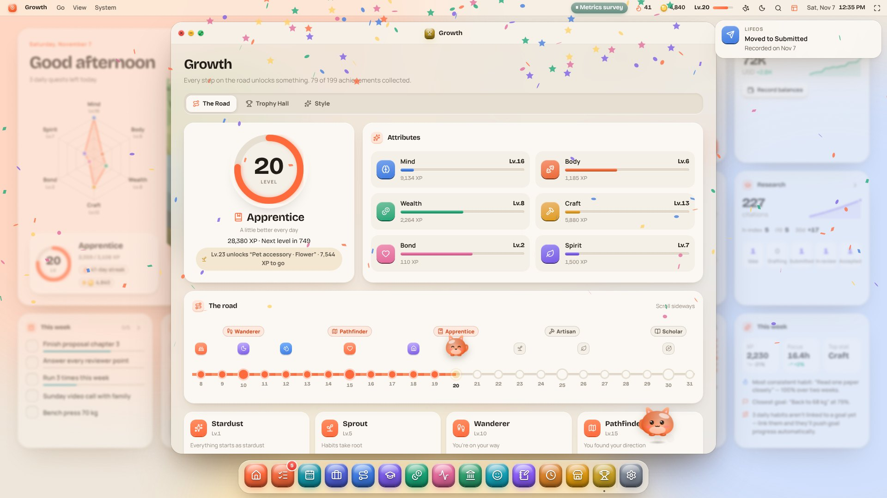

<div align="center">


# LifeOS

**一个为你的人生运行的操作系统**
*An operating system for your life.*

### 多一点记录，多一点专注。

留下自己的痕迹，专注真正重要的事，看得见走过的每一步。

**中文** · [English](README.md)

[**▶ 在线体验**](https://yubol-bobo.github.io/LifeOS/) · [**观看宣传片**](https://yubol-bobo.github.io/LifeOS/promo/) · [上手指南](SETUP.zh-CN.md) · [完整功能](docs/FEATURES.zh-CN.md) · [更新日志](CHANGELOG.md)

<a href="https://yubol-bobo.github.io/LifeOS/promo/"></a>

<sub>↑ 点击观看 80 秒完整版（有配音和音效）</sub>

</div>

---

## 为什么做 LifeOS

我们读什么、写什么、怎么做决定，越来越多地经过 AI。这很方便，却也让人忍不住想：一天结束时，有多少思考和选择是真正属于**自己**的？AI 和数据正在一点点渗进我们的思考与选择，在这个过程里，**给自己多留下一些痕迹**变得更重要：做了什么、学到了什么、心情如何、时间去了哪里。

与此同时，信息多到消化不完，手上同时推进的项目也越来越多：工作、论文、健身、副业、想读的书……每件事都在动，每件都没理清，忙了很久，却说不清到底往前走了多少。

LifeOS 想帮你用一种有规律的方式管理和记录生活，把注意力放回自己觉得**真正重要**的事情上，并且**看得见走过的每一步**。

- **留下痕迹**：任务、计划、专注、笔记、心情、复盘，都是你亲手写下的。一句话也算数，任何一天以后都能再点开回看。
- **专注重要的事**：项目把相关的任务、计划、目标和专注时间收在一起；年 → 月 → 周 → 今天层层拆解，大目标变成今天能做的小事；专注环形图告诉你时间是不是花在了你想花的地方。
- **每一步都看得见**：小事会自动推动大事，一次打卡、一段专注都会推高周、月、年的进度；「足迹」把这一切按时间排好。
- **让记录成为习惯**：经验值、等级、成就、会长大的星球和陪着你的桌面宠物，让人愿意每天回来。
- **痕迹只属于你**：没有服务器、没有账号，数据只存在你的浏览器里；多设备同步是端到端加密的，存进你自己的私密 Gist。AI 是可选的，用你自己的 Key；它可以帮你整理一天，但留下来的是你自己写下的话。

## 它能做什么

| | |
| --- | --- |
| 🖥️ **桌面** | 像操作系统一样的仪表盘：等级和属性雷达、今日任务、今日收入、今日时间分配的 3D 环形图、正在推进的项目进度、人生进度、XP 热力图，还有一颗随你成长的 3D 星球 |
| ✅ **任务与计划** | 每日习惯 + 一次性任务；年 → 月 → 周 → 今天层层拆解，完成后自动向上推进。今日任务可以按数量关联计划（「读这本书 +3 章」），周、月、年进度一起往前走；每一步都能写一句笔记 |
| 📁 **项目** | 把项目拆成步骤，每步可以设截止日期（可选）；步骤不会自动挤进今日任务。看板分筹划中 / 进行中 / 已完成（学术论文也在里面），拖动换阶段，每次变更都有记录；每张卡片都能一键开始专注，还能选哪些项目显示在桌面上 |
| ⏱️ **赚钱与专注** | **赚钱**：给赚钱的工作计时，收入逐秒上涨。**项目专注**：一键开始专注某个项目（或健身、阅读……）。倒计时可以 +15 分 / +30 分 / +1 小时叠加，归零自动结算、放烟花；中途可以暂停、切换到别的任务，之后随时恢复。赚钱和项目各有一个可选的每日目标 |
| 🐾 **桌面宠物** | 三只小伙伴提醒你喝水、起身、睡觉；接入 OpenAI / Claude / DeepSeek / Kimi / GLM 后，每晚帮你写一份今日总结 |
| 📝 **每日复盘** | 一句话也算数：高光、收获、卡点、感恩、明天最重要的一件事；附带复盘热力图和「一年前的今天」 |
| 🕰️ **足迹** | LifeOS 记下的一切按时间排好，可以搜索和筛选；任何一天都能点开，配一张可爱的 3D 经验方块图 |
| 🌱 **成长** | 100 级、20 个时代、199 个成就；解锁宠物配饰、壁纸和星球进化 |
| 📊 **更多** | 心情与影响因素分析、资产与净资产曲线、论文看板（从想法拖到接收，每个阶段都记下日期）、Google Scholar 引用自动同步、数值追踪、奖励商店 |

中英双语 · 明亮 / 暗夜主题 · 每周从周一或周日开始 · 竖版卡片流 / 横版全屏仪表盘 · 手机也能用。每个功能的详细说明见 **[完整功能说明](docs/FEATURES.zh-CN.md)**。

## 截图

| | |
| --- | --- |
|  |  |
| **桌面**（暗夜模式） | **项目**：看板、专注进度条、暂停中的任务 |
|  |  |
| **赚钱**：工作计时，收入逐秒上涨 | **倒计时结束**：自动结算，放烟花 |
|  |  |
| **学术**：论文在各阶段之间拖动 | **计划**：每一步进展都能写一句 |
|  |  |
| **宠物写的今日总结** | **每日复盘**和复盘热力图 |
|  |  |
| **足迹**：一切可追溯 | **通往 Lv.100 的路**：20 个时代 |

---

## 使用指南

### 1. 先试试（1 分钟）

打开 **<https://yubol-bobo.github.io/LifeOS/>**，在设置助手里选「先看看示例数据」随便点点。想正式开始时，到 **系统设置** 点「清空并开始」。

> 每个人打开这个网址，看到的都是**自己浏览器里**的 LifeOS，互相看不到对方的数据。

### 2. 拥有你自己的 LifeOS（推荐，3 步）

1. 点仓库右上角的 **Fork**，复制一份到你的 GitHub。
2. 在你的仓库里打开 **Settings → Pages → Source**，选 **GitHub Actions**。
3. 等一两分钟，打开 `https://<你的用户名>.github.io/LifeOS/`。

以后原项目更新了，在你的仓库页面点 **Sync fork** 就能升级（[详细说明](SETUP.zh-CN.md#11-fork-之后怎么同步更新--自己继续扩充)）。

### 3. 按需打开（都是可选的）

| 想要 | 怎么做 | 详细步骤 |
| --- | --- | --- |
| 电脑和手机同步 | 系统设置 → 同步：填一个只勾 `gist` 权限的 GitHub token，再设一个同步密码 | [SETUP §8](SETUP.zh-CN.md#8-多设备同步电脑--手机) |
| 宠物写今日总结 | 系统设置 → AI 宠物：选服务商，填 API Key | [SETUP §9](SETUP.zh-CN.md#9-ai-宠物今日总结) |
| 自动同步 Google Scholar 引用 | 仓库 Secret `SERPAPI_KEY` + Variable `SCHOLAR_ID` | [SETUP §3–4](SETUP.zh-CN.md#3-google-scholar-id) |
| 切到别的标签页也能收到提醒 | 系统设置 → 桌面宠物 → 浏览器通知 | [SETUP §7](SETUP.zh-CN.md#7-浏览器通知宠物提醒) |

Key 和 token **只填在网页里或 GitHub Secrets 里**，永远不要写进代码。完整的配置清单见 **[上手指南](SETUP.zh-CN.md)**。

### 4. 每天怎么用

- **早上**：看一眼桌面上的今日任务和倒计时；在「计划」里把本周计划「加到今天」，或者加一条「阅读 +3 章」，自动推进本月的阅读计划。
- **白天**：在项目卡片上点 ▶（赚钱的工作就在「赚钱」里点开始），想要倒计时就 +30 分或 +1 小时，归零自动结算。临时有急事？先暂停、切过去，之后从菜单栏恢复。项目或论文往前走了，就拖到下一栏。
- **晚上**：点一下心情，花一分钟写复盘；或者点宠物 →「今日总结」，改两句存进复盘。
- **想回头看的时候**：打开「足迹」，或者点任何一张热力图上的任意一天。

小技巧：`⌘K` / `Ctrl+K` 可以搜索并打开一切；右上角可以切换横版仪表盘和全屏。

### 5. 备份

数据在浏览器里。换电脑或清理浏览器之前，到 **系统设置 → 通用 → 导出备份** 下载 JSON，在新设备上导入即可。开了同步就不用担心这一步。

---

## 数据与隐私

- **没有后端，没有账号**。数据保存在浏览器的 `localStorage` 里。
- **同步是端到端加密的**：数据在你的设备上加密后，才存进你自己的私密 Gist，GitHub 也看不到内容。
- **AI 是可选的**：Key 只存在当前浏览器里。生成总结时，浏览器把当天的摘要直接发给你选的服务商，不经过任何中间服务器。
- **可以放心公开仓库、让别人 fork**：仓库里只有代码和虚构的示例数据，你的记录、Key、密码都不在里面（[详细说明](SETUP.zh-CN.md#10-自己用的同时公开给别人-fork隐私)）。

## 本地开发

```bash
git clone https://github.com/yubol-bobo/LifeOS.git
cd LifeOS
npm install
npm run dev
```

`npm run build` 生成的 `dist/` 是纯静态站点，可以放到任何静态托管上。推送到 `main` 会通过 GitHub Actions 自动发布到 Pages。

想改游戏数值？都在 [`src/store/rules.ts`](src/store/rules.ts)。代码结构和技术栈见 [完整功能说明](docs/FEATURES.zh-CN.md#技术栈)。

## License

MIT。欢迎 fork 和改造，做成你自己的 LifeOS。
